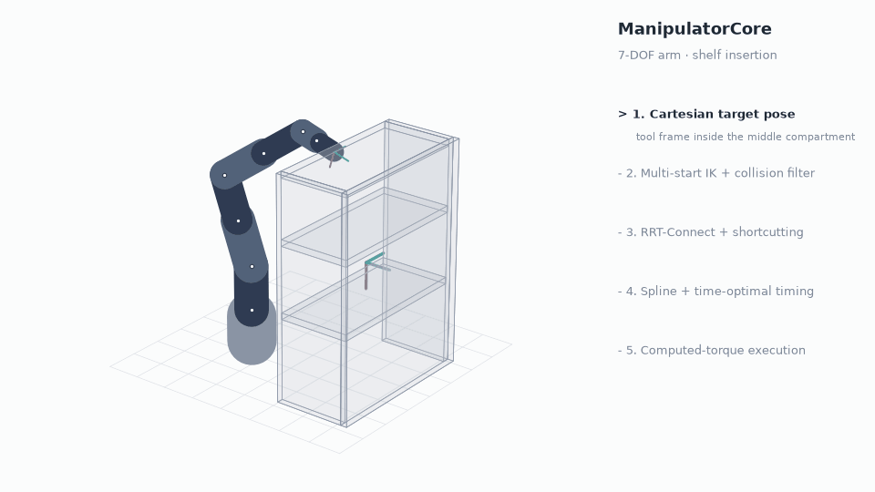
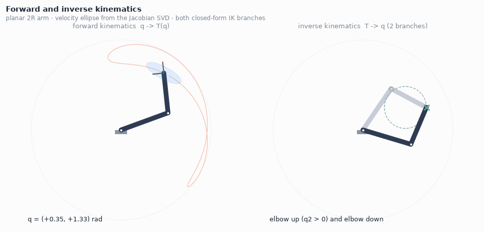
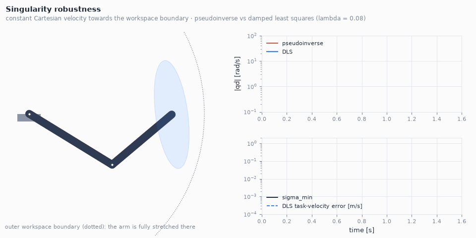
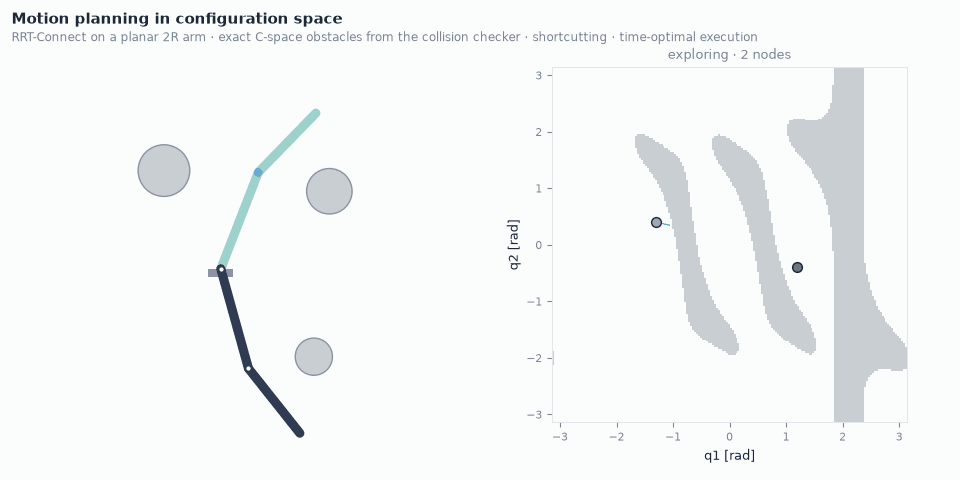
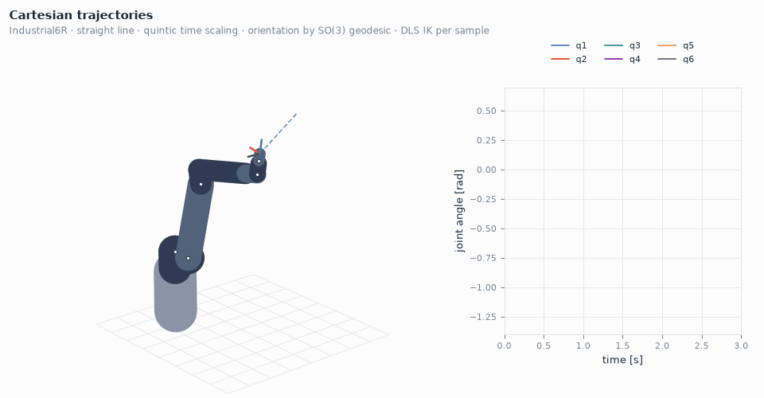
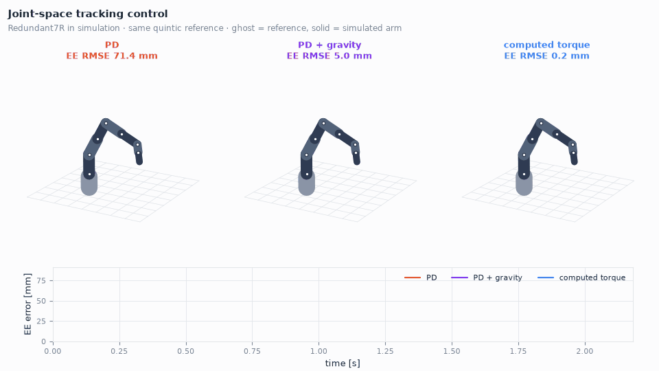
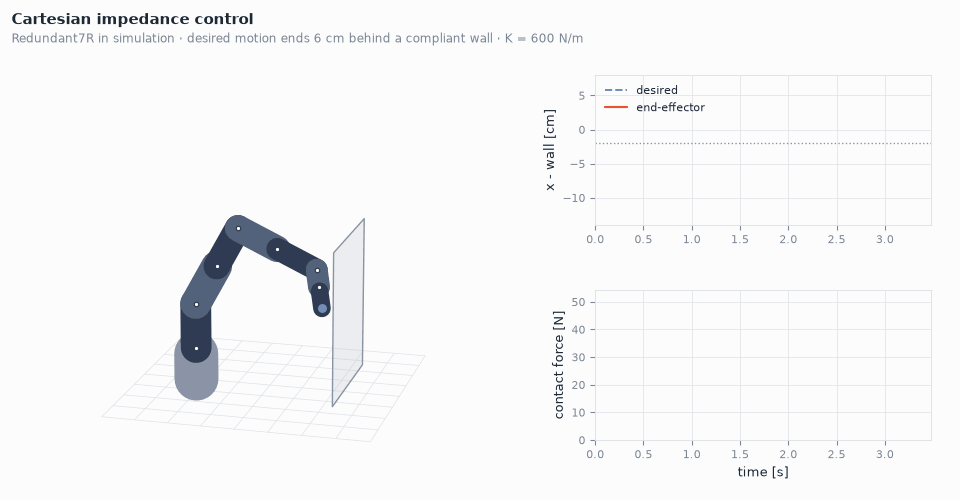
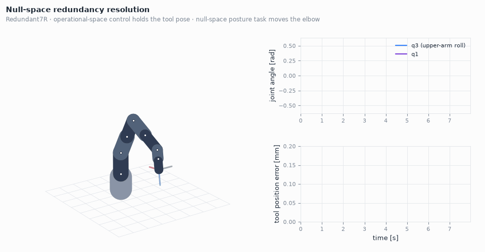
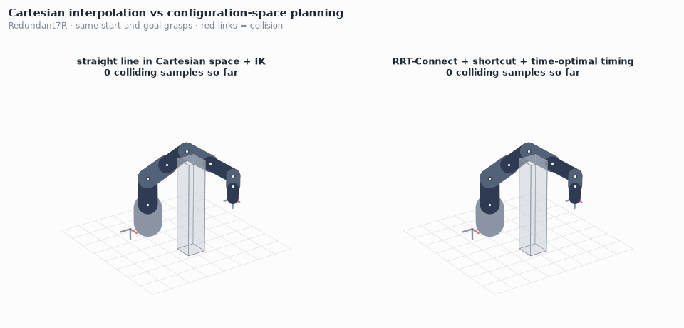
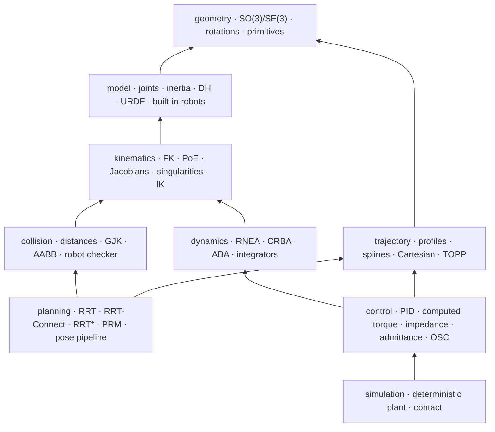

<div align="center">



# ManipulatorCore

**A modern C++20 classical robot-manipulation library: rigid-body geometry, kinematics, dynamics, inverse kinematics, collision-aware motion planning, trajectory generation and task-space control, with reproducible CPU simulation and visual demonstrations.**

[](CMakeLists.txt)
[](CMakeLists.txt)
[](LICENSE)
[](tests)
[](Jenkinsfile)
[](docs/tutorials/getting-started.md)
[](docs/adr/0004-visualization-pipeline.md)
[](ros2)

</div>

The hero animation shows the complete pipeline on a generic 7-DOF arm. A Cartesian goal inside a
shelf is solved by collision-filtered multi-start IK (ghost arms). RRT-Connect plans to each candidate
and the shortest path is kept after shortcutting (blue). The path is smoothed into a spline and
re-checked, then timed under joint velocity and acceleration limits. A computed-torque controller
executes it in the simulator; the orange trace is the **simulated** end-effector, not a replay.

## Why ManipulatorCore

* **One coherent stack.** Robot description → FK/Jacobians → IK → dynamics → collision → planning →
  time parameterization → control → simulation, sharing one set of conventions and types.
* **Explicit conventions.** Frames (`T_a_b`), Hamilton quaternions, intrinsic Euler sequences,
  angular-first twists and three named Jacobians, each paired with its matching pose error:
  [conventions](docs/mathematics/conventions.md).
* **Validated numerics.** Jacobians against finite differences on five robots; RNEA, CRBA and ABA
  against a closed-form Lagrangian model and against each other; skew-symmetry of $\dot M - 2C$,
  power balance and energy conservation. IK, planners and controllers are checked against closed-form
  results, brute force and simulation.
* **Robust by design.** SVD-based rank decisions, damped least squares near singularities,
  factorizations instead of inverses, explicit seeds everywhere, no NaNs for valid input,
  exceptions for misuse and status objects for expected failures.
* **Professional engineering.** C++20, warning-free builds (MSVC `/W4 /WX`, GCC/Clang
  `-Wall -Wextra -Wpedantic`), sanitizers, clang-tidy, a Jenkins pipeline, install/export and
  `find_package` support, benchmarks with measured numbers only.
* **Reproducible visuals.** Every figure is computed by the C++ library (`mc_demos`) and drawn on the
  CPU by `scripts/render`; nothing is hand-made.

## Motion gallery

| Forward and inverse kinematics | Singularity: pseudoinverse vs damped least squares |
| :---: | :---: |
|  |  |
| Planar 2R with its Jacobian velocity ellipse; both closed-form IK branches. | A constant Cartesian velocity drives the arm into a stretched singularity: the pseudoinverse joint speed explodes, DLS stays bounded. |
| **RRT-Connect in the exact configuration space** | **Cartesian trajectories on a 6R arm** |
|  |  |
| C-space obstacles computed by the collision checker, two trees, shortcutting, time-optimal execution. | Line and circles with SO(3)-geodesic orientation, solved per sample by warm-started DLS IK. |
| **PD vs PD + gravity vs computed torque** | **Cartesian impedance against a compliant wall** |
|  |  |
| Same reference, simulated plant with torque limits and joint friction. | The contact force settles at the series-spring value of controller and wall stiffness. |
| **Null-space redundancy resolution** | **Honest failure: Cartesian interpolation vs C-space planning** |
|  |  |
| Operational-space control holds the tool pose while a null-space posture task swings the elbow. | A straight Cartesian line collides with the pillar (red); planning in configuration space does not. |

More figures: [collision clearance](docs/assets/collision.gif), [workspace and manipulability](docs/assets/workspace.png),
[four planners compared](docs/assets/planners_2r.png), [narrow passage](docs/assets/narrow_passage.png),
[IK local minimum](docs/assets/ik_local_minimum.png), [admittance](docs/assets/admittance.gif),
[gravity compensation](docs/assets/gravity_hold.gif), [operational-space tracking](docs/assets/operational_space.gif).

## Architecture



The core depends only on Eigen. Adapters sit on top: Python rendering (`python/manipulatorcore_viz`),
pybind11 bindings (`python/bindings`) and an optional ROS 2 package (`ros2/`). Details are in
[docs/architecture/overview.md](docs/architecture/overview.md).

## Quick start

```bash
cmake -S . -B build -DCMAKE_BUILD_TYPE=Release
cmake --build build --parallel
ctest --test-dir build
```

```cpp
#include "manipulatorcore/control/joint_controllers.hpp"
#include "manipulatorcore/kinematics/forward_kinematics.hpp"
#include "manipulatorcore/planning/pose_goal_planning.hpp"
#include "manipulatorcore/planning/scenarios.hpp"
#include "manipulatorcore/simulation/simulator.hpp"

using namespace mc;

const PlanningScenario scene = redundant7RScenarios().at(4);  // tabletop with a box
const RobotCollisionChecker checker(scene.robot, scene.obstacles);
const SE3 goal = endEffectorPose(scene.robot, scene.goal);

// Multi-start IK -> RRT-Connect -> shortcut -> spline + time-optimal timing -> verification.
const PoseGoalPlanningResult plan = planToPose(checker, scene.start, goal);

// Execute with computed torque in the simulator.
VecX kp;
VecX kd;
ComputedTorqueController::criticallyDampedGains(30.0, scene.robot.dof(), kp, kd);
ComputedTorqueController controller(scene.robot, kp, kd, trajectoryReference(plan.trajectory));
Simulator sim(scene.robot);
sim.reset(scene.start);
sim.run(controller, plan.trajectory->duration() + 0.5);
```

Install and consume from another project:

```cmake
find_package(ManipulatorCore CONFIG REQUIRED)
target_link_libraries(my_robot PRIVATE ManipulatorCore::planning ManipulatorCore::control)
```

See [getting started](docs/tutorials/getting-started.md) for presets, sanitizers, Windows and Python.

## Robot models

| Model | DOF | Description |
| --- | :---: | --- |
| `Planar2R` | 2 | two links in the x-y plane, gravity −y; closed-form IK and Lagrangian dynamics reference |
| `Planar3R` | 3 | planar arm with tool orientation; closed-form IK |
| `Industrial6R` | 6 | generic elbow manipulator with spherical wrist, defined by a standard DH table |
| `Redundant7R` | 7 | generic anthropomorphic S-R-S arm (3-axis shoulder, elbow, 3-axis wrist) |

All models carry cylinder-approximated inertias, joint armature, viscous friction (simulator only),
joint limits and capsule collision geometry. They are generic and do **not** reproduce any commercial
robot. Custom robots can be built programmatically, from standard or modified DH tables, or from
URDF (`mc::loadURDF`); `mc::toURDF` exports any model for ROS tooling.

## Kinematics

* Forward kinematics of the general chain, the direct DH product and the product of exponentials
  (space and body forms), cross-validated against each other.
* Space, body and geometric Jacobians, point Jacobians and $\dot J\dot q$; SVD-based rank, condition
  number and Yoshikawa manipulability; workspace sampling.
* IK: closed-form planar 2R/3R (all branches); Jacobian transpose, SVD pseudoinverse, damped least
  squares (fixed or adaptive) and Levenberg–Marquardt on the SO(3)-log pose error; per-component task
  weights; active-set joint-limit clamping (results never leave the limits); null-space objectives
  (joint centering, limit barrier, smooth limit activation, manipulability) with refinement;
  seeded multi-start.

## Dynamics

Recursive Newton–Euler inverse dynamics, composite-rigid-body mass matrix and articulated-body
forward dynamics in body-frame spatial algebra, with joint armature in all three. Also gravity, bias
and Coriolis torques, the Christoffel Coriolis matrix, energies, and explicit Euler,
semi-implicit Euler and RK4 integrators. Validation covers:

* the closed-form 2R Lagrangian model;
* CRBA columns against RNEA, and ABA against a Cholesky solve;
* gravity torques against $\nabla V$;
* skew-symmetry of $\dot M - 2C$, the power balance and fourth-order RK4 convergence.

## Motion planning

RRT, RRT-Connect, RRT\* (Karaman–Frazzoli radius, rewiring with cost propagation) and multi-query PRM
in joint space. Every edge is validated at intermediate states. Collisions are checked against
sphere, capsule, box and half-space primitives, with exact segment distances, GJK and SAT. Paths are
then post-processed:

* random shortcutting;
* spline smoothing that is re-validated and refined;
* time-optimal parameterization (reachability analysis under joint velocity/acceleration limits,
  with grid refinement at spline knots and post-solve verification).

`planToPose` chains all of this from a Cartesian goal to a verified, timed trajectory. Six
deterministic 7-DOF scenarios cover open reach, obstacle avoidance, narrow passage, shelf, tabletop
and around-obstacle. Planners are deterministic for a given seed.

## Control

Gravity compensation, PD/PID (with optional gravity compensation and anti-windup), computed torque
(one RNEA call), Cartesian PD, Cartesian impedance, admittance with measured-force feedback, and
Khatib's operational-space control with a dynamically consistent null-space projector. Redundant arms
get posture stiffness, damping and $C^1$ joint-limit repulsion in the null space. Unit tests check
the closed-loop identities exactly:
* computed torque yields the commanded error dynamics;
* OSC task acceleration equals the command;
* OSC null-space torques cause no task acceleration.

## Benchmarks

Measured on a laptop Intel Core i5-1335U (Release, MSVC 19.50, single thread pinned to one
performance core) with `scripts/benchmark/run_benchmarks.py`. Full tables and protocols are in
[docs/benchmarks/README.md](docs/benchmarks/README.md).

| Kernel (generic 7-DOF arm) | Time per call |
| --- | ---: |
| Forward kinematics | 403 ns |
| Geometric Jacobian | 796 ns |
| Inverse dynamics (RNEA) | 1.5 µs |
| Mass matrix (CRBA) | 2.1 µs |
| Forward dynamics (ABA) | 3.7 µs |
| Collision query, arm vs 7-obstacle shelf incl. self-collision | 4.6 µs |
| DLS IK solve, seed within ±0.3 rad | 43 µs |
| Computed-torque / operational-space control call | 1.6 µs / 10.5 µs |

| Algorithm quality (seeded, reproducible) | Result |
| --- | --- |
| IK, 300 random reachable 6-D targets, cold start | 7R: DLS 66 % → DLS + 8 restarts 99.7 % (median error 0.05 mm); 6R: 32 % → 91 % |
| Planning, 6 scenarios × 5 seeds | RRT-Connect 100 % (median 2.0 ms), PRM 90 %, RRT 67 %, RRT\* 63 % (3 000 samples) |
| Joint-space tracking, Cartesian RMSE | PD 72 mm · PD + gravity 5.0 mm · computed torque 0.22 mm |
| Task-space tracking, Cartesian RMSE | task-space PD 1.2 mm · impedance 1.3 mm · operational space 0.20 mm |

## Simulation

A deterministic fixed-step simulator (RK4 or semi-implicit Euler) with torque saturation, viscous
joint friction, joint-limit stops and a penalty-based compliant contact between a tool sphere and
planar surfaces. The controller runs at the step rate with zero-order hold, and two runs with the
same inputs produce bit-identical logs. It exists to validate control laws; it is not a replacement
for MuJoCo, Gazebo or Isaac Sim. See [simulation](docs/algorithms/simulation.md) for time-step and
stability guidance.

## Documentation

* [Conventions](docs/mathematics/conventions.md) · [Architecture](docs/architecture/overview.md) ·
  [All algorithm pages](docs/README.md) · [Benchmarks](docs/benchmarks/README.md) ·
  [ADRs](docs/adr) · [Rendering the figures](docs/tutorials/rendering.md) ·
  [ROS 2 adapter](docs/tutorials/ros2.md)

### Algorithm status

Generated from [configs/algorithms.yaml](configs/algorithms.yaml) by
`scripts/docs/generate_status_matrix.py`.

<!-- status-matrix:start -->
| Area | Algorithm | Implemented | Tested | Demo | Benchmark |
| --- | --- | :---: | :---: | :---: | :---: |
| Geometry | SO(3)/SE(3) exp, log, adjoint, Lie bracket | ✅ | ✅ | — | ✅ |
| Geometry | Quaternion / axis-angle / Euler (ZYX, XYZ, ZYZ) conversions | ✅ | ✅ | — | ✅ |
| Geometry | SLERP and geodesic / screw pose interpolation | ✅ | ✅ | — | — |
| Model | Serial chain model (revolute/prismatic, inertia, armature, limits) | ✅ | ✅ | — | — |
| Model | Standard and modified Denavit-Hartenberg | ✅ | ✅ | — | — |
| Model | URDF import / export (serial chains) | ✅ | ✅ | — | — |
| Kinematics | Forward kinematics (chain, DH product, PoE space/body) | ✅ | ✅ | [fk_ik_2r](docs/assets/fk_ik_2r.gif) | ✅ |
| Kinematics | Space, body, geometric and point Jacobians; Jdot*qd | ✅ | ✅ | — | ✅ |
| Kinematics | Singularity analysis (SVD rank, condition, Yoshikawa) | ✅ | ✅ | [singularity](docs/assets/singularity.gif) | — |
| Kinematics | Workspace and manipulability sampling | ✅ | ✅ | [workspace](docs/assets/workspace.png) | — |
| IK | Analytical planar 2R / 3R (all branches) | ✅ | ✅ | [fk_ik_2r](docs/assets/fk_ik_2r.gif) | — |
| IK | Jacobian transpose | ✅ | ✅ | — | ✅ |
| IK | SVD pseudoinverse (Gauss-Newton) | ✅ | ✅ | — | ✅ |
| IK | Damped least squares (fixed and adaptive) | ✅ | ✅ | [singularity](docs/assets/singularity.gif) | ✅ |
| IK | Levenberg-Marquardt | ✅ | ✅ | — | ✅ |
| IK | Null-space redundancy resolution (centering, limits, manipulability) | ✅ | ✅ | [nullspace](docs/assets/nullspace.gif) | — |
| IK | Active-set joint-limit clamping and multi-start IK | ✅ | ✅ | [ik_local_minimum](docs/assets/ik_local_minimum.png) | ✅ |
| Dynamics | Recursive Newton-Euler (inverse dynamics, gravity, bias) | ✅ | ✅ | — | ✅ |
| Dynamics | Composite Rigid Body (mass matrix) | ✅ | ✅ | — | ✅ |
| Dynamics | Articulated Body (forward dynamics) | ✅ | ✅ | — | ✅ |
| Dynamics | Closed-form 2R Lagrangian reference and Christoffel Coriolis | ✅ | ✅ | — | — |
| Dynamics | Explicit Euler, semi-implicit Euler, RK4 integration | ✅ | ✅ | [gravity_hold](docs/assets/gravity_hold.gif) | — |
| Trajectory | Cubic / quintic polynomials, trapezoidal and double-S profiles | ✅ | ✅ | — | — |
| Trajectory | C2 cubic splines and synchronized line motion | ✅ | ✅ | — | — |
| Trajectory | Cartesian line / arc with SO(3) geodesic orientation | ✅ | ✅ | [cartesian_paths](docs/assets/cartesian_paths.gif) | — |
| Trajectory | Time-optimal parameterization (reachability, box limits) | ✅ | ✅ | [hero](docs/assets/hero.gif) | — |
| Collision | Sphere / capsule / box / half-space signed distances | ✅ | ✅ | [collision](docs/assets/collision.gif) | — |
| Collision | GJK distance and SAT penetration depth | ✅ | ✅ | — | — |
| Collision | AABB broad phase, self- and environment collision checking | ✅ | ✅ | [collision](docs/assets/collision.gif) | ✅ |
| Planning | RRT | ✅ | ✅ | [planners_2r](docs/assets/planners_2r.png) | ✅ |
| Planning | RRT-Connect | ✅ | ✅ | [rrt_2r](docs/assets/rrt_2r.gif) | ✅ |
| Planning | RRT* | ✅ | ✅ | [planners_2r](docs/assets/planners_2r.png) | ✅ |
| Planning | PRM (k-nearest, A*, multi-query) | ✅ | ✅ | [planners_2r](docs/assets/planners_2r.png) | ✅ |
| Planning | Shortcutting and re-validated spline smoothing | ✅ | ✅ | — | — |
| Planning | Pose goal: IK candidates + planning + timing + verification | ✅ | ✅ | [hero](docs/assets/hero.gif) | — |
| Control | Gravity compensation, PD, PID (anti-windup) | ✅ | ✅ | [gravity_hold](docs/assets/gravity_hold.gif) | ✅ |
| Control | Computed torque | ✅ | ✅ | [computed_torque](docs/assets/computed_torque.gif) | ✅ |
| Control | Cartesian PD (Jacobian transpose) | ✅ | ✅ | — | ✅ |
| Control | Cartesian impedance | ✅ | ✅ | [impedance](docs/assets/impedance.gif) | ✅ |
| Control | Admittance | ✅ | ✅ | [admittance](docs/assets/admittance.gif) | — |
| Control | Operational-space control | ✅ | ✅ | [operational_space](docs/assets/operational_space.gif) | ✅ |
| Control | Null-space posture and smooth joint-limit avoidance | ✅ | ✅ | [nullspace](docs/assets/nullspace.gif) | — |
| Simulation | Deterministic simulator (saturation, damping, limits, contact) | ✅ | ✅ | [impedance](docs/assets/impedance.gif) | — |
| Integration | Python bindings (pybind11) | ✅ | ✅ | — | — |
| Integration | ROS 2 adapter (simulator, planner, URDF, RViz) | 🧪 experimental | ✅ | — | — |
| Roadmap | Torque- and jerk-constrained time parameterization | 🗺️ planned | — | — | — |
| Roadmap | Continuous collision detection and mesh geometry | 🗺️ planned | — | — | — |
| Roadmap | Spatial index (kd-tree) for planners | 🗺️ planned | — | — | — |
| Roadmap | Hybrid force/position control | 🗺️ planned | — | — | — |
<!-- status-matrix:end -->

## Roadmap

* Torque- and jerk-constrained time parameterization.
* Continuous (swept-volume) collision checking and mesh geometry.
* Spatial index (kd-tree) for nearest-neighbour queries in the planners.
* Hybrid force/position control and impedance with inertia shaping.
* Models of public robots, added only where verified parameters and licences permit.

## Licence

[MIT](LICENSE). Eigen (MPL2) is fetched at build time when not installed and is bundled with the
installed headers under its own licence.
