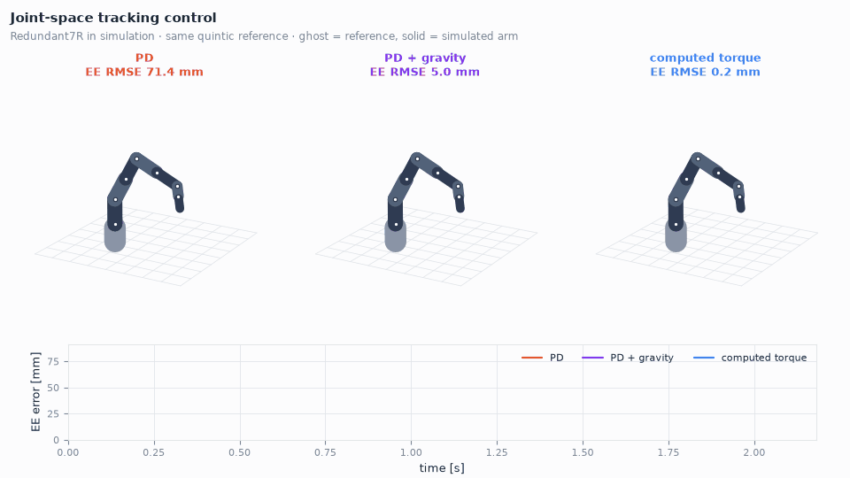

# Joint-space control

## Purpose

Torque controllers that track joint references: gravity compensation, independent-joint PID/PD with
optional gravity compensation, and computed-torque (inverse-dynamics) control.



## Mathematical formulation

Plant: $M(q)\ddot q + C(q,\dot q)\dot q + g(q) = \tau$. Errors $e = q_d - q$, $\dot e = \dot q_d - \dot q$.

* **Gravity compensation**: $\tau = g(q)$. With an exact model the arm holds any configuration
  (and keeps any initial velocity, since nothing dissipates energy except plant friction).
* **PD**: $\tau = K_p e + K_d \dot e$. Under gravity it settles with the steady-state error
  $e_{ss} = K_p^{-1} g(q_{ss})$.
* **PD + gravity compensation**: $\tau = K_p e + K_d\dot e + g(q)$. For a constant setpoint and an
  exact gravity model the equilibrium $q = q_d$ is globally asymptotically stable for positive
  definite $K_p, K_d$ (Takegaki & Arimoto 1981), via the Lyapunov function
  $V = \tfrac12\dot q^\top M\dot q + \tfrac12 e^\top K_p e$ and the skew-symmetry of $\dot M - 2C$.
* **PID**: adds $K_i\int e\,dt$ with the integral clamped to $\pm$`integral_limit` (anti-windup).
* **Computed torque**:
  $$\tau = M(q)\left(\ddot q_d + K_d\dot e + K_p e\right) + C(q,\dot q)\dot q + g(q),$$
  which, for an exact model, yields the decoupled linear error dynamics
  $\ddot e + K_d\dot e + K_p e = 0$. `criticallyDampedGains(omega)` sets $K_p = \omega^2 I$,
  $K_d = 2\omega I$.

## Assumptions

* Joint positions and velocities are measured exactly; torques are applied exactly (the simulator adds
  saturation and viscous friction as plant effects the controllers do not model).
* Computed torque assumes an accurate dynamic model; a different (perturbed) `RobotModel` can be
  passed to study robustness.

## Conventions

Gains are per-joint vectors (N·m/rad, N·m·s/rad, N·m/(rad·s)); references come from a
`JointReferenceFn` (`constantJointReference`, `trajectoryReference`).

## Algorithm

Computed torque is evaluated with **one RNEA pass** on the commanded acceleration
$a = \ddot q_d + K_d\dot e + K_p e$: $\tau = \mathrm{RNEA}(q, \dot q, a) = M a + C\dot q + g$, which avoids
forming $M$. The PID integrator uses the time difference between consecutive calls and rejects
decreasing time.

## Implementation

[joint_controllers.hpp](../../include/manipulatorcore/control/joint_controllers.hpp):
`GravityCompensationController`, `JointPIDController`, `ComputedTorqueController`;
[controller.hpp](../../include/manipulatorcore/control/controller.hpp): the `Controller` interface and
reference helpers; [metrics.hpp](../../include/manipulatorcore/control/metrics.hpp): tracking metrics.

## Numerical considerations

* The closed-loop stiffness of computed torque is limited by the control period: with zero-order hold
  at 1 kHz, $\omega$ of a few tens of rad/s is comfortably stable with RK4.
* Joint damping in the plant is not cancelled by the controllers; it causes a small, bounded
  tracking error that the benchmark reports.

## Configuration

`JointPIDGains{kp, ki, kd}`, `gravity_compensation` flag, `integral_limit`; computed-torque `kp`, `kd`.

## Example

```cpp
#include "manipulatorcore/control/joint_controllers.hpp"
#include "manipulatorcore/simulation/simulator.hpp"

using namespace mc;
const RobotModel arm = makeRedundant7R();
auto traj = std::make_shared<PolynomialTrajectory>(
    PolynomialTrajectory::quintic(redundant7RHome(), VecX::Constant(7, 0.4), 2.0));
VecX kp, kd;
ComputedTorqueController::criticallyDampedGains(25.0, 7, kp, kd);
ComputedTorqueController ctc(arm, kp, kd, trajectoryReference(traj));
Simulator sim(arm);
sim.reset(redundant7RHome());
sim.run(ctc, 2.5);
```

## Benchmark

Joint RMSE, Cartesian RMSE, effort, peak torque and settling time of PD, PD + gravity, PID + gravity
and computed torque on a common trajectory: [benchmarks](../benchmarks/README.md).

## Limitations

* No friction compensation, actuator dynamics or torque-rate limits in the controllers.
* Computed torque is sensitive to model errors (no adaptive or robust terms).

Validated in [test_control.cpp](../../tests/unit/test_control.cpp) (computed torque produces exactly the
commanded error dynamics) and [test_control_loops.cpp](../../tests/integration/test_control_loops.cpp)
(gravity holding, PD steady-state error, PD + gravity convergence, integral action, controller ranking).

## References

* M. Takegaki and S. Arimoto, "A new feedback method for dynamic control of manipulators", *ASME Journal of Dynamic Systems, Measurement, and Control*, 103(2), 1981.
* M. W. Spong, S. Hutchinson and M. Vidyasagar, *Robot Modeling and Control*, Wiley, 2006 (ch. 8).
* B. Siciliano, L. Sciavicco, L. Villani and G. Oriolo, *Robotics: Modelling, Planning and Control*, Springer, 2009 (ch. 8).
