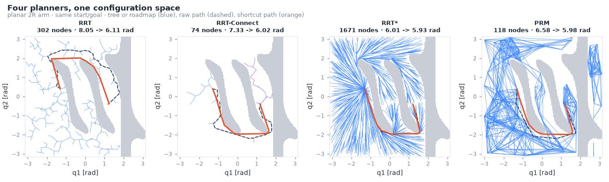

# Motion planning

## Purpose

Collision-free joint-space paths between configurations, and an integrated pipeline from a Cartesian
goal pose to a timed, verified joint trajectory.



## Mathematical formulation

Planning happens in the bounded configuration space $\mathcal{C} = [q_{min}, q_{max}] \subset
\mathbb{R}^n$ with the weighted metric $d(a, b) = \sqrt{\sum_i w_i (a_i - b_i)^2}$. A path is valid if
every configuration on it is inside the limits and collision free. Edges are straight lines in
$\mathcal{C}$ and are validated at intermediate states spaced at most `resolution` apart in the
max-norm, so no joint moves more than the resolution between two checked states.

* **RRT** (LaValle 1998): sample (goal bias $p_g$), extend the nearest node by at most $\eta$
  (`max_step`), add the edge if valid, connect to a goal within $\eta$.
* **RRT-Connect** (Kuffner & LaValle 2000): two trees (start and all goals); EXTEND one tree towards a
  sample, then greedily CONNECT the other tree to the new node; swap roles each iteration.
* **RRT\*** (Karaman & Frazzoli 2011): for each new node, choose the parent minimizing cost-to-come
  among neighbours within
  $r_n = \min\!\left(\gamma\,(\log n / n)^{1/d},\ r_{max}\right)$,
  $\gamma = \rho \cdot 2\left(1 + \tfrac1d\right)^{1/d}\left(\mu(\mathcal{C})/\zeta_d\right)^{1/d}$
  ($\rho$ = `rewire_factor`, $\zeta_d$ the unit-ball volume), then rewire neighbours through it and
  propagate cost changes to their subtrees. The cost is the joint-space path length. RRT\* uses its
  full iteration budget (anytime) and returns the best goal connection under the final costs.
* **PRM** (Kavraki et al. 1996), $k$-nearest variant: valid samples are connected to their $k$
  nearest neighbours by validated edges; queries add start and goals to the roadmap and run A\* with
  the metric to the nearest goal as an admissible heuristic. The roadmap grows in batches until the
  query succeeds or the budget is spent, and is reused by later queries (multi-query).

## Assumptions

* Static environment; collision checking through a user-supplied validity function (typically
  `RobotCollisionChecker::isCollisionFree`).
* Revolute joints are treated within their limits (no wrap-around), so $\mathcal{C}$ is a box.

## Conventions

Paths are `std::vector<VecX>` from start to goal; lengths are in the joint-space metric (rad).

## Algorithm

**Post-processing.** `shortcutPath` repeatedly picks two random points *anywhere* along the path
(not only at waypoints) and replaces the detour between them by a straight edge when it is valid.
`smoothPathWithSpline` fits a natural cubic spline through the waypoints, densely re-validates it,
and if it leaves the valid set, subdivides the polyline (pulling the spline towards it) and retries.
If no valid spline is found the polyline is kept and timed with stop-at-waypoint trapezoids.

**Pose-goal pipeline** (`planToPose`):

```text
target pose
  -> multi-start IK (collision-free candidates, closest to start first)
  -> plan to each of the first k candidates (RRT-Connect by default)
  -> shortcut each path, keep the shortest
  -> spline smoothing (re-validated) + time-optimal parameterization
  -> verify the timed trajectory densely against the caller's checker
```

IK filtering and planning use a copy of the checker with an **environment clearance** (2 cm by
default) that covers the motion between discrete edge checks; the final verification uses the
original checker without the margin, and a failed verification is reported, never hidden.

`PlannerSettings::record_tree` copies the search tree (nodes in insertion order, final parents,
tree membership) or the PRM roadmap edges into the result. The demo application `mc_demos`
(`apps/demos`) uses it to export planner trees for the [renderer](../../scripts/render/render_rrt_arm.py).

## Implementation

* [joint_space.hpp](../../include/manipulatorcore/planning/joint_space.hpp): `JointSpace`, `MotionValidator`.
* [planner.hpp](../../include/manipulatorcore/planning/planner.hpp): `MotionPlanner`, `RRTPlanner`,
  `RRTConnectPlanner`, `RRTStarPlanner`, `PRMPlanner`, `makePlanner`.
* [path_processing.hpp](../../include/manipulatorcore/planning/path_processing.hpp): `pathLength`,
  `densifyPath`, `shortcutPath`, `smoothPathWithSpline`.
* [pose_goal_planning.hpp](../../include/manipulatorcore/planning/pose_goal_planning.hpp): `planToPose`,
  `timeParameterizePath`.
* [scenarios.hpp](../../include/manipulatorcore/planning/scenarios.hpp): six 7-DOF scenarios (open reach,
  obstacle avoidance, narrow passage, shelf reach, tabletop reach, around obstacle) and two planar
  2R scenarios.

## Numerical considerations

* All randomness comes from an explicitly seeded `mc::Random`; with `time_limit = 0` every planner is
  bit-for-bit deterministic (tested).
* Nearest-neighbour queries are linear scans over contiguous storage: simple and exact, adequate for
  the tens of thousands of nodes used here.

## Configuration

`PlannerSettings`: `seed` (1), `max_iterations` (20000), `time_limit` (0 = off), `max_step` (0.4),
`goal_bias` (0.05), `rewire_factor` (1.1), `max_rewire_radius` (1.0), `prm_neighbors` (10),
`prm_batch` (200), `record_tree` (false). `PoseGoalPlanningOptions`: IK options, planner name,
`edge_resolution` (0.02), `clearance` (0.02 m), `max_goal_candidates` (4), shortcut, smoothing and
timing options, `verification_dt` (5 ms).

## Example

```cpp
#include "manipulatorcore/planning/pose_goal_planning.hpp"
#include "manipulatorcore/planning/scenarios.hpp"

using namespace mc;
const PlanningScenario scene = redundant7RScenarios().at(4);  // tabletop_reach
const RobotCollisionChecker checker(scene.robot, scene.obstacles);
const PoseGoalPlanningResult r = planToPose(checker, scene.start, endEffectorPose(scene.robot, scene.goal));
if (r.success) {
  const TrajectoryPoint p = r.trajectory->sample(0.5 * r.trajectory->duration());
}
```

## Benchmark

Success rate, planning time, path length, nodes and collision checks over the six scenarios:
[benchmarks](../benchmarks/README.md). The narrow-passage comparison (RRT vs RRT-Connect) is shown in
[narrow_passage.png](../assets/narrow_passage.png).

## Limitations

* No kd-tree or other spatial index for nearest neighbours.
* Joint-space metric only (no task-space costs or clearance costs in RRT\*).
* PRM roadmaps are tied to one static environment.
* Discrete edge checking; the clearance must be chosen consistently with the edge resolution.

Validated in [test_planning.cpp](../../tests/unit/test_planning.cpp) (open, blocked and narrow-passage
worlds, determinism, invalid inputs, RRT\* cost monotonicity, PRM reuse, shortcutting, spline
re-validation, scenario validity) and
[test_planning_pipeline.cpp](../../tests/integration/test_planning_pipeline.cpp) (all scenarios solved
and re-checked at a finer resolution; the pose pipeline's trajectory respects limits and is collision
free).

## References

* S. M. LaValle, "Rapidly-exploring random trees: a new tool for path planning", TR 98-11, Iowa State University, 1998.
* S. M. LaValle, *Planning Algorithms*, Cambridge University Press, 2006.
* J. J. Kuffner and S. M. LaValle, "RRT-Connect: an efficient approach to single-query path planning", ICRA 2000.
* S. Karaman and E. Frazzoli, "Sampling-based algorithms for optimal motion planning", *International Journal of Robotics Research*, 30(7), 2011.
* L. E. Kavraki, P. Svestka, J.-C. Latombe and M. H. Overmars, "Probabilistic roadmaps for path planning in high-dimensional configuration spaces", *IEEE Transactions on Robotics and Automation*, 12(4), 1996.
* R. Geraerts and M. H. Overmars, "Creating high-quality paths for motion planning", *International Journal of Robotics Research*, 26(8), 2007 (path shortcutting).
