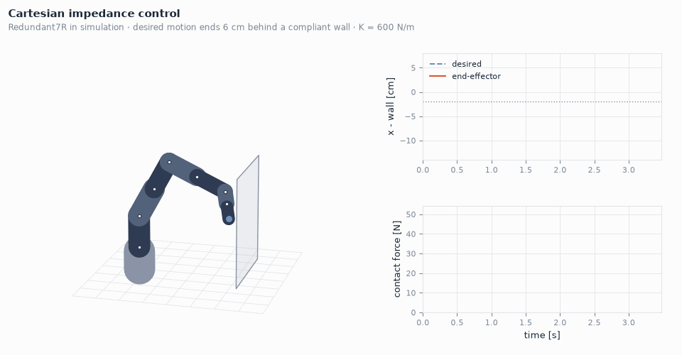

# Task-space and interaction control

## Purpose

Controllers that act on the end-effector pose: Cartesian PD, Cartesian impedance, admittance and
operational-space control, with null-space posture tasks for redundant arms.



## Mathematical formulation

All controllers use the world-aligned pose error and the geometric Jacobian $J$ (rows $[\omega; v]$):

$$
e = \begin{bmatrix} \log(R_d R^\top)^\vee \\ p_d - p \end{bmatrix}, \qquad V = J\dot q .
$$

* **Cartesian PD (Jacobian transpose)**:
  $\tau = J^\top\big(K_p e + K_d(V_d - V)\big) + g(q) + N^\top\tau_0$.
* **Impedance control without inertia shaping** (Hogan 1985):
  $\tau = J^\top\big(K e + D(V_d - V)\big) + C(q,\dot q)\dot q + g(q) + N^\top\tau_0$. At rest
  against an environment the interaction wrench is $K e$; the apparent inertia is the robot's own
  task-space inertia (no force sensor needed).
* **Admittance control**: the measured force drives a virtual mass-spring-damper on the
  translational deviation $x_e = x_c - x_d$,
  $M_d\ddot x_e + D_d\dot x_e + K_d x_e = F_{ext}$ (semi-implicit Euler at the control rate). An inner
  resolved-acceleration loop tracks the commanded pose $x_c$:
  $\ddot q_{ref} = J^{\#}\big(a_c + K_d(V_c - V) + K_p e_c - \dot J\dot q\big) + N(-D_n\dot q)$,
  $\tau = \mathrm{RNEA}(q, \dot q, \ddot q_{ref}) - J^\top F_{ext}$. Cancelling the measured wrench makes
  the inner loop an ideal motion source, so the compliance is set by $(M_d, D_d, K_d)$ alone.
* **Operational-space control** (Khatib 1987):
  $$
  \Lambda = (J M^{-1} J^\top)^{-1},\quad \bar J = M^{-1}J^\top\Lambda,\quad
  F = \Lambda\,(a^* - \dot J\dot q) + \bar J^\top h,\quad
  \tau = J^\top F + (I - J^\top\bar J^\top)\,\tau_0,
  $$
  with $a^* = a_d + K_d(V_d - V) + K_p e$ and $h = C\dot q + g$. Then $J\ddot q + \dot J\dot q = a^*$
  exactly (linear, decoupled task dynamics), and $J M^{-1}(I - J^\top\bar J^\top) = 0$, so $\tau_0$
  causes no task acceleration (dynamically consistent null space).

**Null-space tasks.** $\tau_0 = K_n(q_{posture} - q) - D_n\dot q - k_{lim}\nabla H_{lim}(q)$, where
$H_{lim}$ is a $C^1$ quadratic penalty active only within a fraction of the range near each limit, so
the repulsion has no discontinuities. PD and impedance project with the orthogonal projector
$N = I - J^+J$; OSC uses the dynamically consistent projector above.

## Assumptions

* Exact model for OSC and the admittance inner loop; the measured wrench for admittance is the
  contact wrench about the end-effector origin (base frame), as a wrist force/torque sensor would
  report.
* Gains are symmetric 6×6 matrices ordered [rotation; translation].

## Conventions

See [conventions](../mathematics/conventions.md): twists $[\omega; v]$, wrenches $[m; f]$, geometric
Jacobian with the end-effector origin as reference point.

## Algorithm

`operationalSpaceTerms` computes $M$ (CRBA), solves $M^{-1}J^\top$ with a Cholesky factorization,
eigen-decomposes $\Lambda^{-1} = JM^{-1}J^\top$ and **clamps its eigenvalues from below**
(`singularity_threshold`), which keeps $\Lambda$ and the task force bounded near singularities at the
cost of exactness in the degenerate directions. $\dot J\dot q$ comes from
`geometricJacobianDotTimesVelocity`.

## Implementation

[task_space_controllers.hpp](../../include/manipulatorcore/control/task_space_controllers.hpp):
`TaskSpacePDController`, `CartesianImpedanceController`, `AdmittanceController`,
`OperationalSpaceController`, `operationalSpaceTerms`, `NullSpaceTask`, `diagonalGain`.

## Numerical considerations

* Jacobian-transpose schemes need no inversion and stay well-behaved at singularities, but their
  closed-loop task dynamics vary with configuration.
* OSC exactness degrades where $\Lambda$ is regularized; the posture task keeps the null-space motion
  bounded.
* Admittance with a stiff environment and a small virtual mass needs a small time step (the demos use
  0.5 ms with an 8 kN/m wall).

## Configuration

`NullSpaceTask{posture, stiffness, damping, joint_limit_gain, joint_limit_activation}`,
`AdmittanceParameters{mass, damping, stiffness}` (per axis), OSC `singularity_threshold` (1e-4).

## Example

```cpp
#include "manipulatorcore/control/task_space_controllers.hpp"

using namespace mc;
const RobotModel arm = makeRedundant7R();
const VecX q0 = redundant7RHome();
const SE3 goal = endEffectorPose(arm, q0) * SE3::fromTranslation(Vec3(0.0, 0.1, 0.05));
OperationalSpaceController osc(arm, diagonalGain(100, 100), diagonalGain(20, 20), constantPoseReference(goal),
                               NullSpaceTask{q0, 10.0, 3.0, 10.0, 0.1});
```

## Benchmark

Cartesian RMSE, orientation RMSE, effort, peak torque and time per call for Cartesian PD, impedance
and OSC on a common Cartesian trajectory: [benchmarks](../benchmarks/README.md).

## Limitations

* No explicit force control or hybrid position/force control.
* Impedance does not shape the apparent inertia; admittance handles translation only (orientation
  tracks the reference).
* The contact model used for validation is a penalty model (see [simulation](simulation.md)).

Validated in [test_control.cpp](../../tests/unit/test_control.cpp) (OSC task acceleration equals $a^*$;
null-space torques produce no task acceleration; bounded output at a singular configuration;
impedance wrench equals $K e$) and [test_control_loops.cpp](../../tests/integration/test_control_loops.cpp)
(convergence, Cartesian tracking, and steady contact forces matching the series combination of
controller and wall stiffness for impedance and admittance).

## References

* N. Hogan, "Impedance control: an approach to manipulation, parts I-III", *ASME Journal of Dynamic Systems, Measurement, and Control*, 107(1), 1985.
* O. Khatib, "A unified approach for motion and force control of robot manipulators: the operational space formulation", *IEEE Journal of Robotics and Automation*, 3(1), 1987.
* B. Siciliano, L. Sciavicco, L. Villani and G. Oriolo, *Robotics: Modelling, Planning and Control*, Springer, 2009 (ch. 8-9).
* K. M. Lynch and F. C. Park, *Modern Robotics*, Cambridge University Press, 2017 (ch. 11).
