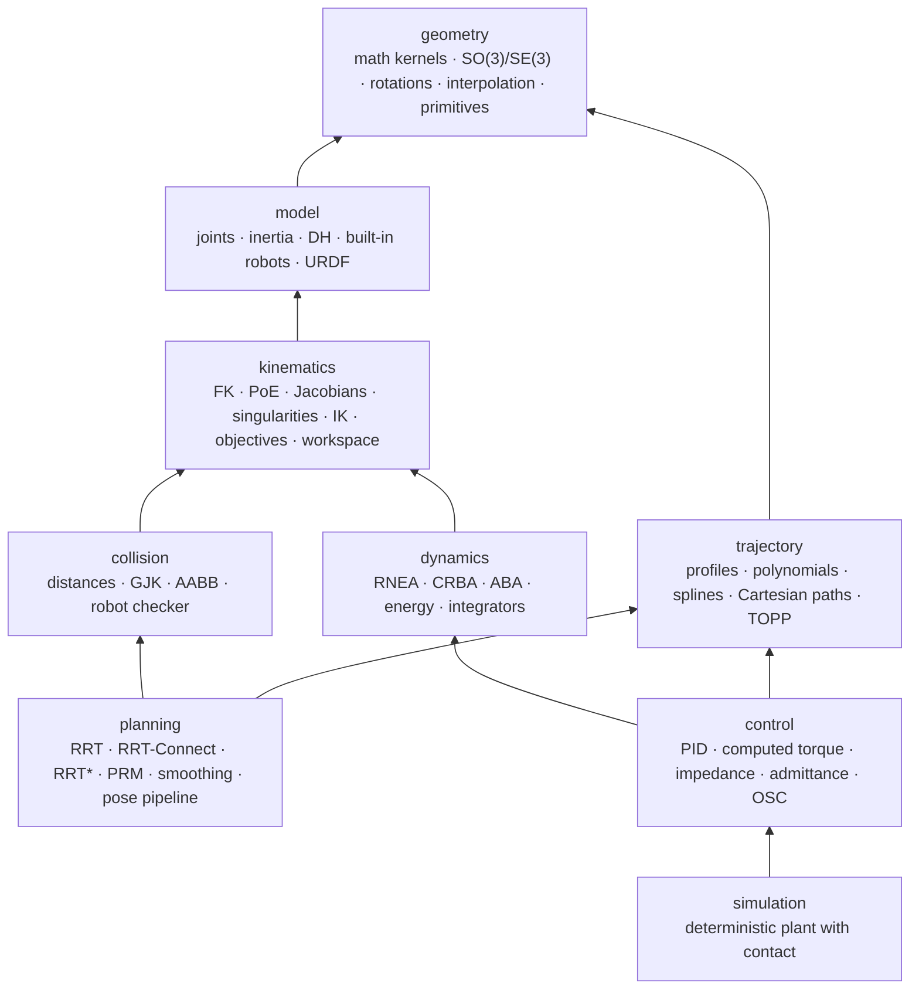
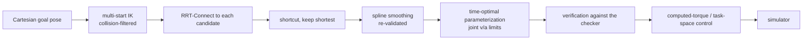

# Architecture

ManipulatorCore is a C++20 library of static modules with a strict dependency order, plus
applications (demos, benchmarks, examples) and optional adapters (Python rendering, pybind11
bindings, ROS 2). The core depends only on Eigen and the C++ standard library.

## Modules



Each module is a CMake target `ManipulatorCore::<module>`; `ManipulatorCore::ManipulatorCore` links
all of them. Headers live in `include/manipulatorcore/<module>/`, sources in `src/<module>/`.

## Data flow of the integrated pipeline



`planToPose` covers steps A–G; the controllers and the simulator consume the resulting
`JointTrajectory` through `trajectoryReference`.

## Adapters and applications

```text
ManipulatorCore (C++20, Eigen)
    ├── apps/demos       mc_demos: computes demo data, exports JSON
    ├── apps/benchmarks  mc_metric_benchmarks: algorithm-quality tables
    ├── benchmarks/      mc_benchmarks: Google Benchmark kernels
    ├── python/          manipulatorcore_viz (renders JSON) · pybind11 bindings (optional)
    └── ros2/            manipulatorcore_ros (optional colcon package)
```

## Policies

* **Conventions** are defined once in [conventions](../mathematics/conventions.md) and used everywhere.
* **Errors.** Invalid input or configuration throws `mc::InvalidArgument`; expected algorithmic
  outcomes (IK not converged, planner budget exhausted) are reported through result structs with a
  status. No function returns NaN or infinity for valid input. Library code never prints.
* **Numerics.** Rank decisions and pseudoinverses use the SVD with explicit tolerances; linear systems
  are solved with factorizations (LLT/LDLT/QR/SVD), never with explicit inverses.
* **Determinism.** All randomized algorithms take an explicit seed and use `mc::Random`
  (`std::mt19937_64` with its own uniform mapping), so results are reproducible across platforms.
* **Threading.** `RobotCollisionChecker` queries are `const` and compute forward kinematics locally,
  so a checker can be shared between threads. `MotionValidator` counts queries in mutable counters and
  planners keep internal state; use one validator and one planner per thread. Stateful controllers
  (PID, admittance) must be called with non-decreasing time.
* **Ownership.** Value types for models and geometry; `std::shared_ptr<const T>` for immutable shared
  paths, trajectories and validators; no raw owning pointers.

## Build and install

CMake ≥ 3.21. Eigen is used from the system when found, otherwise fetched (headers only) and installed
alongside the library, so `find_package(ManipulatorCore CONFIG REQUIRED)` works from a plain install
prefix (see [examples/external_project](../../examples/external_project)). Libraries are static.
